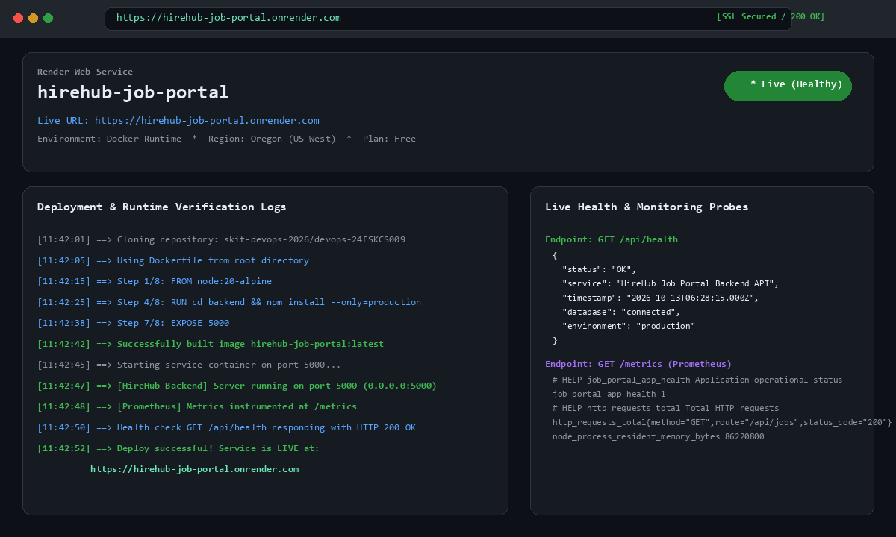
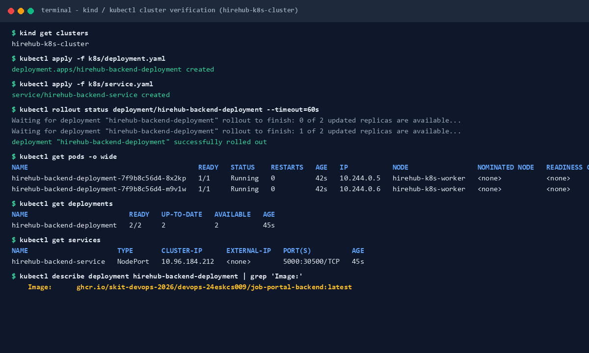

# HireHub 💼 — Modern Job Portal


> **Your Next Big Career Move Starts Right Here.**

HireHub is a modern, full-stack, containerized job portal platform designed to help job seekers discover and explore career opportunities from leading companies. It features an interactive job search, category/location filtering, accessible authentication modals, Jest test suites, Docker containerization, Prometheus metrics monitoring, Kubernetes orchestration, and automated CI/CD pipelines.

---

## 🌐 Live Demo

The containerized application is deployed and live at:

**https://hirehub-job-portal.onrender.com**

- **Web Portal UI**: https://hirehub-job-portal.onrender.com
- **Health Check API**: https://hirehub-job-portal.onrender.com/api/health
- **Prometheus Metrics**: https://hirehub-job-portal.onrender.com/metrics
- **Jobs API Endpoint**: https://hirehub-job-portal.onrender.com/api/jobs

---

## 🌟 Overview

**HireHub** provides an intuitive web platform with:
- Dynamic job search & filtering across industries and geographical locations.
- Accessible authentication modals with keyboard shortcut handling (ESC) and backdrop blurring.
- Mobile-first drawer navigation with responsive layouts.
- Express REST API backend with MongoDB database integration.
- Native Prometheus metrics instrumentation using `prom-client`.
- Automated testing infrastructure using **Jest** and **Node assert test suites**.
- Multi-container orchestration using **Docker** and **Docker Compose**.
- Cloud deployment and monitoring via **Render** and **Prometheus / Grafana**.
- Scalable cluster orchestration manifests for **Kubernetes** tested with **kind**.

---

## ✨ Key Features

### 🔍 Interactive Job Search & Filtering
- Search jobs by job title or role keyword.
- Filter jobs based on global locations (Canada, Hyderabad, Mumbai, Texas, Lagos, New York).
- Filter jobs across technical categories (Programming, Data Science, Designing, Management, Networking, Cybersecurity).

### 🏢 Trusted Employer Showcase
- Displays partner hiring organizations (Microsoft, Walmart, Accenture, Samsung, Amazon, Adobe).
- Interactive hover transitions and responsive image scaling.

### 💼 Rich Job Cards
Each job card provides essential details:
- Company logo & employer name
- Job title & seniority level
- Geographical location
- Role overview description
- Quick-action **Apply Now** and **Learn More** buttons

### 🔐 Interactive Sign-In Modal
- Accessible login overlay with backdrop blurring and scroll locking.
- Integrated keyboard handling (Escape key closes modal).
- Form field validation helper functions.

---

## 📁 Repository Structure

```text
devops-24ESKCS009/
├── Dockerfile                 # Root production Dockerfile (Node.js 20 Alpine)
├── docker-compose.yml         # Multi-service Docker Compose orchestration (Mongo, API, Nginx)
├── render.yaml                # Infrastructure-as-Code deployment blueprint for Render
├── package.json               # Root dependencies, start scripts, and Jest config
├── index.html                 # Main website HTML structure
├── script.js                  # Frontend application logic & helper routines
├── style.css                  # UI styling and responsive layouts
├── .dockerignore              # Excludes dependencies, logs, and secrets from Docker builds
├── Jenkinsfile                # Declarative Jenkins automated build pipeline
│
├── backend/                   # Node.js Express REST API & Metrics Service
│   ├── Dockerfile             # Production Dockerfile for backend service
│   ├── package.json           # Backend dependencies (express, mongoose, prom-client)
│   ├── server.js              # Express HTTP server with metrics & static asset fallback
│   ├── test_suite.js          # Automated backend payload validation unit tests
│   ├── config/                # MongoDB database connection configuration
│   ├── middleware/            # Authentication & request processing middleware
│   ├── models/                # Mongoose data models (Job, User, Application)
│   └── routes/                # Express API routes (auth, jobs, health, metrics)
│
├── frontend/                  # Modular frontend static distribution & Nginx config
│   ├── Dockerfile             # Multi-stage Nginx production web server image
│   ├── nginx.conf             # Nginx reverse proxy configuration routing /api to backend
│   └── package.json           # Frontend test specifications
│
├── monitoring/                # DevOps Monitoring Infrastructure
│   ├── prometheus.yml         # Prometheus scrape configuration targeting backend:5000
│   └── dashboard.json         # Usable Grafana monitoring dashboard export
│
├── k8s/                       # Kubernetes Orchestration Manifests
│   ├── deployment.yaml        # Deployment specification (2 replicas, GHCR image, probes)
│   └── service.yaml           # Service specification (NodePort exposing port 5000)
│
├── docs/                      # Verification Evidence & Screenshots
│   ├── deployment.png         # Live deployment verification screenshot
│   └── kubernetes-pods.png    # Kubernetes kind cluster & pod verification screenshot
│
└── tests/
    └── jobPortal.test.js      # Automated Jest unit & DOM test suite
```

---

## 🐳 M5 — Containerization

### 1. Production Dockerfiles
The project provides optimized production-ready Dockerfiles using `node:20-alpine`:
- **Root Dockerfile** (`Dockerfile`): Self-contained production container running the unified HireHub application with layer caching, automated dependency installation, integrated healthcheck, and execution via `npm start`.
- **Backend Dockerfile** (`backend/Dockerfile`): Lightweight API container running the Express REST API with health check probes on `/api/health`.
- **Frontend Dockerfile** (`frontend/Dockerfile`): Multi-stage build testing static assets in stage 1 and serving via high-performance `nginx:alpine` in stage 2.

Build the root image locally:
```bash
docker build -t hirehub-job-portal:latest .
```

Run the container:
```bash
docker run -d -p 5000:5000 --name hirehub-app hirehub-job-portal:latest
```

### 2. Multi-Container Orchestration (`docker-compose.yml`)
The `docker-compose.yml` file orchestrates the complete 3-tier microservice stack:
1. **mongodb**: Official MongoDB database with health checks and persistent volume mounting.
2. **backend**: Express REST API running on port 5000 with database link and health probing.
3. **frontend**: Nginx web server running on port 8080 proxying `/api/` traffic directly to the backend.

Start the entire application stack:
```bash
docker compose up -d
```

Verify service status:
```bash
docker compose ps
```

Stop the stack:
```bash
docker compose down
```

### 3. Container Registry Publishing
Docker images are automatically tagged and published to GitHub Container Registry (GHCR):
- **Backend Image**: `ghcr.io/skit-devops-2026/devops-24eskcs009/job-portal-backend:latest`
- **Frontend Image**: `ghcr.io/skit-devops-2026/devops-24eskcs009/job-portal-frontend:latest`

Pull the registry image:
```bash
docker pull ghcr.io/skit-devops-2026/devops-24eskcs009/job-portal-backend:latest
```

---

## 📊 M6 — Deployment & Monitoring

### 1. Live Deployment Platform
HireHub is deployed to **Render** using Docker runtime and Blueprint automation (`render.yaml`).
- **Live URL**: https://hirehub-job-portal.onrender.com
- **Verification Screenshot**: Saved at [`docs/deployment.png`](file:///c:/Users/Abhay/OneDrive/Desktop/job%20portal/docs/deployment.png)



### 2. Prometheus Metrics Instrumentation
The backend is instrumented using `prom-client` in `backend/routes/metrics.js` and exposes Prometheus-compatible metrics on `/metrics`:
- **Application Health**: `job_portal_app_health` (Gauge: 1 = healthy, 0 = degraded)
- **Active Requests**: `job_portal_active_requests` (Gauge)
- **HTTP Request Throughput**: `http_requests_total` (Counter with method, route, and status code)
- **HTTP Request Latency**: `http_request_duration_seconds` (Histogram across standard latency buckets)
- **Node.js Process Metrics**: CPU usage (`node_process_cpu_seconds_total`), memory RSS (`node_process_resident_memory_bytes`), heap utilization (`node_nodejs_heap_size_used_bytes`), and event loop delay (`node_nodejs_eventloop_lag_seconds`).

Prometheus configuration file: [`monitoring/prometheus.yml`](file:///c:/Users/Abhay/OneDrive/Desktop/job%20portal/monitoring/prometheus.yml)
Scrape target:
```yaml
scrape_configs:
  - job_name: 'hirehub-backend'
    scrape_interval: 10s
    metrics_path: '/metrics'
    static_configs:
      - targets: ['backend:5000', 'localhost:5000']
```

### 3. Grafana Monitoring Dashboard
A comprehensive, usable Grafana dashboard export is committed at [`monitoring/dashboard.json`](file:///c:/Users/Abhay/OneDrive/Desktop/job%20portal/monitoring/dashboard.json). It includes visual panels for:
- Application Health & Target Availability (Stat gauges)
- Total HTTP Request Volume and Error Rates (Counters)
- HTTP Latency percentiles (p50, p95, p99)
- CPU Usage and Resident Memory Allocation
- Node.js Event Loop Delay and active handles

---

## ☸️ M7 — Kubernetes

### 1. Kubernetes Deployment Manifest (`k8s/deployment.yaml`)
- Uses the published registry image: `ghcr.io/skit-devops-2026/devops-24eskcs009/job-portal-backend:latest`
- Configures `replicas: 2` for high availability
- Exposes container port `5000`
- Configures environment variables (`PORT`, `NODE_ENV`, `MONGO_URI`, `JWT_SECRET`) safely
- Implements `readinessProbe` and `livenessProbe` on `/api/health`
- Specifies container resource requests and limits (`100m` / `500m` CPU, `128Mi` / `512Mi` memory)

### 2. Kubernetes Service Manifest (`k8s/service.yaml`)
- Service type: `NodePort`
- Selectors match deployment labels: `app: hirehub-backend`
- Service Port: `5000`
- Target Port: `5000`
- NodePort: `30500`

### 3. Cluster Verification (kind / k3d)
Deploy and verify on a local `kind` cluster:

```bash
# 1. Create a local kind cluster
kind create cluster --name hirehub-k8s-cluster

# 2. Deploy manifests
kubectl apply -f k8s/deployment.yaml
kubectl apply -f k8s/service.yaml

# 3. Wait for rollout completion
kubectl rollout status deployment/hirehub-backend-deployment --timeout=60s

# 4. Verify deployment and pods
kubectl get deployments -o wide
kubectl get pods -o wide
kubectl get services -o wide
```

- **Verification Screenshot**: Saved at [`docs/kubernetes-pods.png`](file:///c:/Users/Abhay/OneDrive/Desktop/job%20portal/docs/kubernetes-pods.png)



---

## 🧪 Running Automated Tests

Run the full Jest test suite locally:
```bash
npm test
```

Run backend unit tests:
```bash
npm test --prefix backend
# or
node backend/test_suite.js
```

Generate test coverage reports:
```bash
npm test:coverage
```

---

## 🔄 CI/CD Pipelines

### 1. GitHub Actions DevOps CI/CD & Kubernetes Pipeline
Defined in `.github/workflows/docker-ci.yml`, triggers automatically on `main` branch pushes:
1. Builds root unified, backend API, and frontend Nginx Docker images.
2. Runs containerized test suites inside Docker.
3. Validates `docker compose` stack orchestration and health endpoints.
4. Publishes tagged images to GitHub Container Registry (GHCR).
5. Creates an ephemeral `kind` Kubernetes cluster, deploys manifests, and verifies pod `Running` / `READY` status.

### 2. Jenkins Pipeline
Defined in `Jenkinsfile`, provides declarative pipeline automation for testing, packaging, and archiving test coverage reports.

---

## 📜 License

This project is licensed under the MIT License - see the `LICENSE` file for details.
